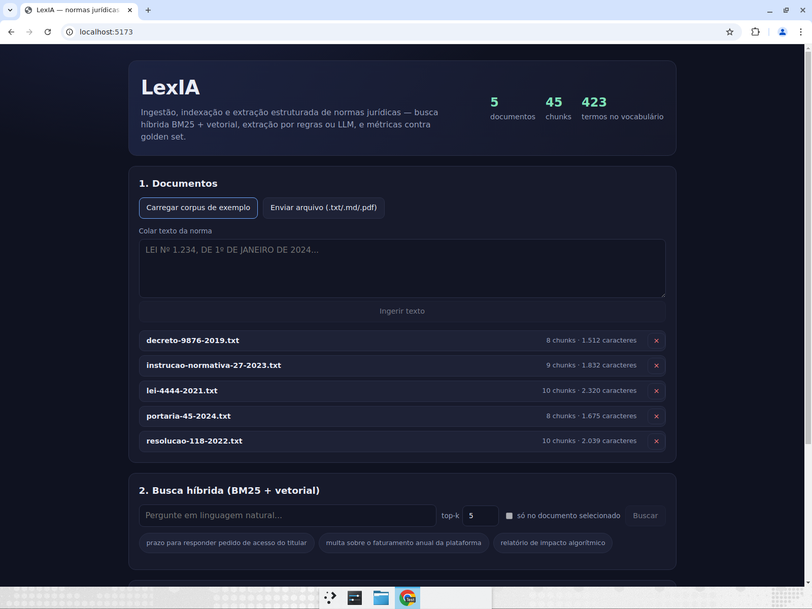
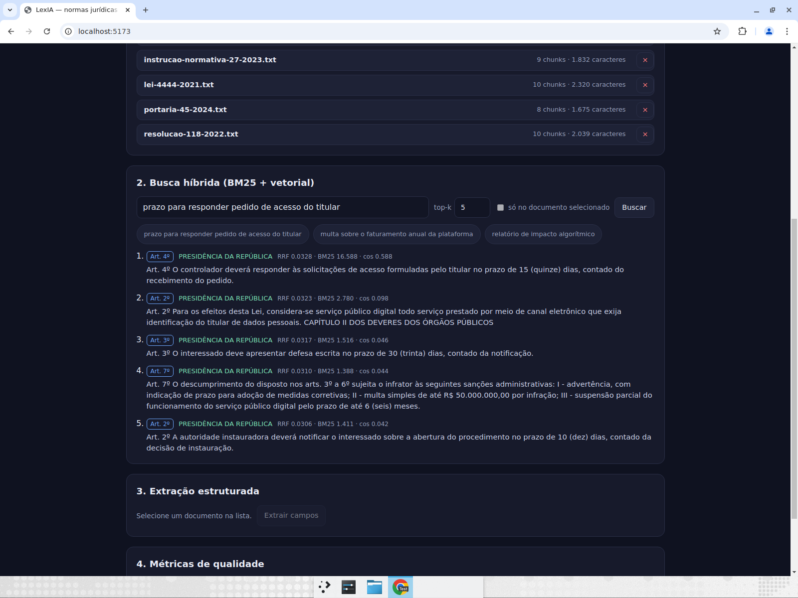
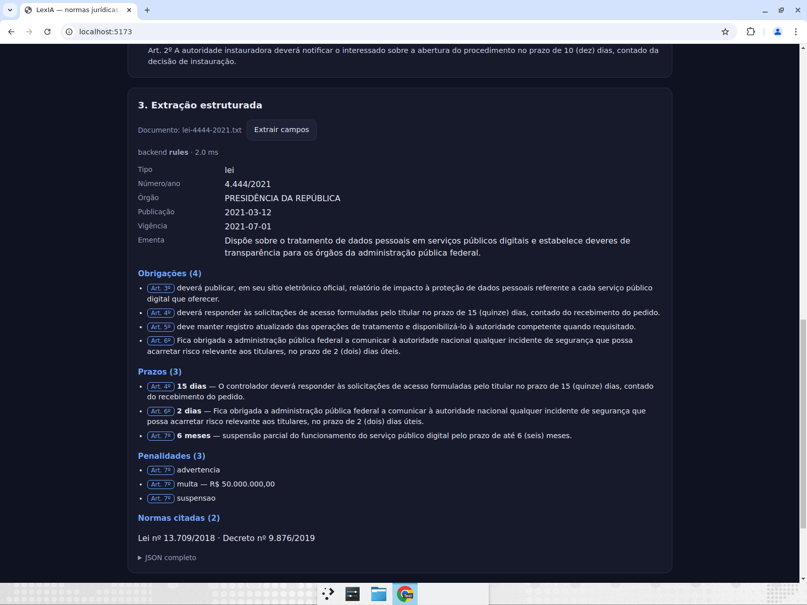
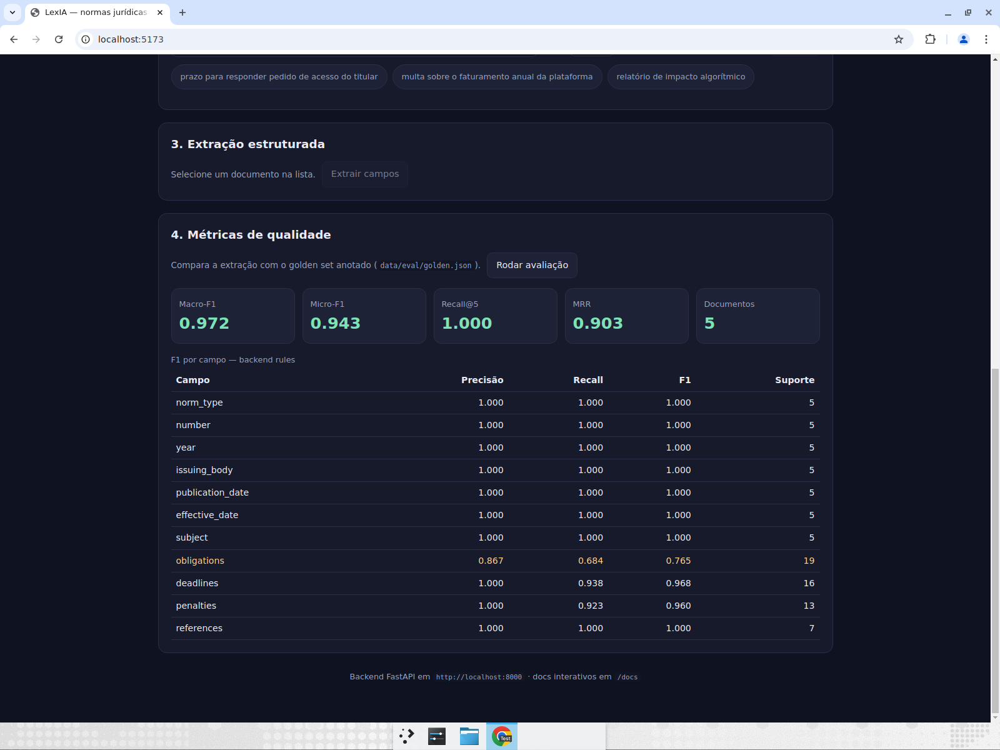

# LexIA — Análise Inteligente de Normas Jurídicas

[](https://github.com/igorsilvadev01/LexIA---An-lise-Inteligente-de-Normas-Jur-dicas/actions/workflows/ci.yml)
[](lexia/lexia/LICENSE)

Pipeline para ingestão, busca híbrida e extração estruturada de normas jurídicas, com avaliação automática contra um golden set anotado. Este README é uma visão curta, voltada para apresentação em portfólio. Para documentação técnica completa, veja `lexia/lexia/README.md`.

## Destaques (para portfólio)
- Macro‑F1 na extração: **0.972** (golden set anotado)
- Recall@5 / MRR da busca: **1.000 / 0.903**
- Backend em FastAPI (Python), frontend em React + TypeScript
- 127 testes automatizados (113 pytest + 14 vitest) e cobertura de backend ~95%

## Visual (interface)


Galeria:







---

## Quickstart (mínimo)
Pré‑requisitos: Python ≥ 3.10, Node ≥ 20

Backend
```bash
cd lexia/lexia/backend
python -m venv ../../.venv
source ../../.venv/bin/activate   # Windows: ..\.venv\Scripts\activate
pip install -e ".[dev]"
uvicorn app.api:app --reload --port 8000
```

Frontend
```bash
cd lexia/lexia/frontend
npm install
npm run dev    # http://localhost:5173
```

Testes rápidos
```bash
cd lexia/lexia/backend && pytest
cd lexia/lexia/frontend && npm test
```

---

## Roadmap resumido
Veja o roadmap completo: `lexia/lexia/docs/ROADMAP.md` — nele há prioridades claras para tornar o projeto pronto para produção e apresentação.

---

## Como apresentar este projeto em um portfólio / currículo
- Linha curta para o currículo: "LexIA — pipeline offline para extração e busca jurídica; Macro‑F1 0.972; busca híbrida BM25+vetorial com RRF; FastAPI + React."
- No portfólio: inclua a visão geral (imagem), link para o repositório, link direto para `docs/EVALUATION.md` e `docs/TEST_EVIDENCE.md` (evidências de testes e métricas).
- Em entrevistas: destaque a decisão técnica de manter extração por regras como baseline e medir ganho do LLM com o mesmo golden set.

---

## Links rápidos
- Documentação técnica completa: `lexia/lexia/README.md`
- Guia rápido (passo a passo): `lexia/lexia/COMECE_AQUI.md`
- Roadmap detalhado: `lexia/lexia/docs/ROADMAP.md`

